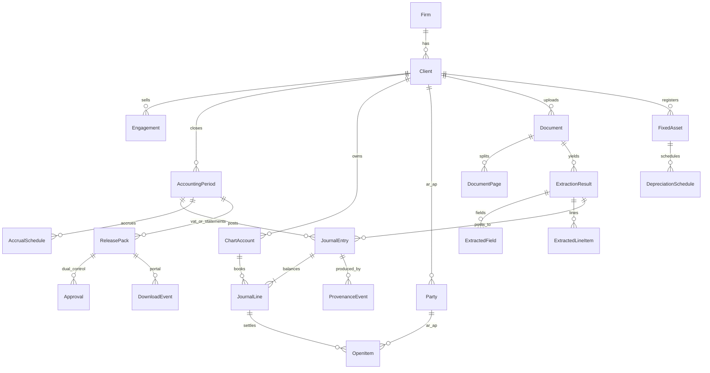

# 02 — System of record and domain model (arnibooks)

**Retrieval date for web citations: 2026-10-03.**  
**Tally is out of scope** (no integration, export, or validation against Tally).  
**SoR decision:** arnibooks is the single system of record for bookkeeping, VAT and tax per client.

## 1. Summary

arnibooks owns a double-entry ledger: chart of accounts, journals, period locks, AR/AP, multi-currency, and DB-enforced balanced entries. VAT201, financial statements and corporate tax are reports off that ledger. Clients (or Arnifi accountants) download an approved pack and file in the FTA portal; the product never submits. This document recommends **building the ledger core in-repo** after a licence-aware build-vs-adopt analysis, defines the domain model (Mermaid ER), and specifies opening/cut-over, accruals, depreciation, closing/RE, and reopen-period with audit. Approvals bind to a hash of the exact dataset approved; any upstream change voids release.

## 2. Options table — ledger core

| Option | Licence (cited) | Pros | Cons | Est. effort to production SoR | Reversibility |
|---|---|---|---|---|---|
| **B1 Build in this Postgres/RLS app** | N/A (owned) | Fits Next/worker stack; tenant isolation native; VAT control accounts designed in | Must implement close/statements/FA | Stage A likely 16 pw (doc 01) | High (schema owned) |
| **B2 Adopt Apache Fineract** | Apache-2.0 — [github.com/apache/fineract](https://github.com/apache/fineract) | Permissive licence; GL/journals exist | Microfinance/core-banking shape; Java stack; multi-tenant mapping tax | Spike 2 pw + rewrite **UNVERIFIED** 20–40 pw | Medium |
| **B3 Adopt LedgerSMB** | GPLv2 — [ledgersmb.org](https://ledgersmb.org/faq), [book.ledgersmb.org licence](https://book.ledgersmb.org/dev/split-book/sec-ledgersmb-license.html) | True double-entry on PostgreSQL | Perl; GPL SaaS counsel risk; UAE VAT gap | High rewrite | Low |
| **B4 Adopt ERPNext accounts** | GPLv3 — [github.com/frappe/erpnext](https://github.com/frappe/erpnext) | Mature accounts/FA/AR/AP | Frappe monolith; GPL; product becomes ERPNext fork | High | Low |
| **B5 Adopt Bigcapital** | AGPLv3 — [github.com/bigcapitalhq/bigcapital](https://github.com/bigcapitalhq/bigcapital) | TS stack closer to us | AGPL network-copyleft for SaaS; inventory-heavy | Medium–high + commercial licence? | Low |
| **B6 Akaunting** | BSL 1.1 forbids Accounting Service — [akaunting.com/license](https://akaunting.com/license) | — | **Disqualified** for multi-client practice SaaS under Additional Use Grant (3) | — | — |
| **B7 Buy SaaS ledger** | Vendor ToS | Fast books | Not owned SoR; VAT pack / portal / UAE rules constrained | Subscription **UNVERIFIED** | Low lock-in exit |

## 3. Recommendation (confidence: **high** for SoR = arnibooks; **medium-high** for build)

**Build the ledger core in-repo (B1).** Disqualify Akaunting (BSL). Do not adopt GPL/AGPL ERPs as the product kernel without counsel. Optional **≤2 person-week spike** on Fineract (Apache-2.0 only) if leadership wants a second opinion; default path does not wait on that spike.

Evidence that would change this: spike shows Fineract (or another Apache-2.0/MIT ledger) embeds under our RLS with UAE COA + VAT controls and saves ≥8 person-weeks through Stage D2.

### 3.1 Reporting posture (UAE)

| Framework | When allowed / required | Product posture |
|---|---|---|
| Full IFRS | Default for CT — [MoF MD 114/2023](https://mof.gov.ae/wp-content/uploads/2023/05/Ministerial-Decision-No.-114-of-2023-on-the-Accounting-Standards-and-Methods-for-Corporate-Tax-Purposes.pdf) Art. 4(1) | Support later if client revenue > AED 50m |
| IFRS for SMEs | CT election if revenue ≤ AED 50m — MD 114/2023 Art. 4(2); FTA guide 2023-11-06 — [tax.gov.ae](https://tax.gov.ae/Datafolder/Files/Guides/CT/Accounting%20Standards%20Guide%20-%2006%2011%202023.pdf) | **Target layout** |
| Management accounts | Internal | **Label until accounting lead sign-off** |
| Companies Law accounts | Federal Decree-Law 32/2021 Art. 27 requires international standards for LLC/JSC annual accounts — [MoET PDF](https://www.moet.gov.ae/documents/20121/376326/Commercial+Companies.pdf/12d14f53-1a3e-47b4-8e70-fac3f672c403) | External auditor pack is out of Stage A |

### 3.2 Release and filing (product rules)

| Rule | Spec |
|---|---|
| FTA submit | **Never** from arnibooks |
| Who files | Client or Arnifi accountant in FTA portal (outside product) |
| Release | Preparer user_id ≠ approver user_id for first **90 days** |
| Download | Only `RELEASED` versions; show status, version, date; every download logged |
| Void | Any change to hashed inputs → status demotes; re-approval required |

## 4. Domain model

### 4.1 Core tables (logical)

| Entity | Key fields | Invariants |
|---|---|---|
| `clients` | trn, base_currency, reporting_framework_label | TRN validated before VAT recoverable claims |
| `accounting_periods` | start, end, status (`OPEN`/`CLOSED`/`REOPENED`) | Postings only into `OPEN` or explicitly `REOPENED` |
| `chart_accounts` | code, type, currency, control flags (AR/AP/VAT/Bank) | Hierarchical COA per client |
| `journal_entries` | period_id, source_document_id?, posted_at, status | Σ debit = Σ credit in minor units; reject otherwise **in DB** |
| `journal_lines` | account_id, party_id?, debit, credit, currency, fx_rate | Money integer minor units (AED fils scale-2; reject 3-decimal currencies as today) |
| `documents` / `pages` / `extraction_results` | sha256, mime, ocr_method, model_version | Re-extract creates new result version; never overwrite approved |
| `open_items` | party, original_entry, outstanding | AR/AP sub-ledger |
| `fixed_assets` / `depreciation_schedules` | cost, method, life, residual | Posting generated journals |
| `accrual_schedules` | start/end, account pair | Auto reverse next period option |
| `release_packs` | kind (`VAT201`/`STATEMENTS`/`CT`), version, content_hash, status | Download only if `RELEASED` |
| `approvals` | preparer_id, approver_id, content_hash, approved_at | preparer ≠ approver (90-day rule); hash must match pack |
| `download_events` | user_id, pack_id, at, ip_hash | Append-only |
| `provenance_events` | method, model/rule_version, input_hash | Every posted value |

### 4.2 Approval hashing

`content_hash = H(canonical JSON of pack inputs + journal ids + rule versions + statement numbers)`.  
Store hash on `approvals` and `release_packs`. Any mutation of hashed set → pack status = `STALE`; downloads blocked until new dual approval.

## 5. Opening balances and cut-over

| Cut-over artefact | Import shape | Validation |
|---|---|---|
| Trial balance | CSV/XLSX: account code, debit, credit, as-of date | Σ D = Σ C; map to COA; opening journal in period 0 |
| Open AR/AP | party, invoice ref, date, outstanding, currency | Sum by control account = TB control |
| Bank balances | account, as-of, amount | Equals TB cash/bank lines |
| Fixed assets | asset id, cost, accum depr, method, life, in-service date | NBV ties to TB FA nets |
| Equity / RE | opening RE + share capital lines | A = L + E after opening journal |

**Cut-over journal:** single balanced `OPENING_BALANCE` entry (or per-module set) tagged non-reversing. Lock opening period after sign-off.  
**Idempotency:** import file sha256; reject duplicate imports unless `force` with audit reason.

## 6. Accruals, depreciation, close, equity

| Process | Behaviour |
|---|---|
| Accruals / prepayments | Schedule → proposed journals → human approve → post; optional auto-reverse next period |
| Depreciation | FA register → monthly/periodic schedule → proposed depr journals → approve → post |
| Period close | Checklist (recon done, accruals posted, VAT pack released or waived, TB identity) → status `CLOSED`; block new posts |
| Reopen | Requires reason, actor, ticket ref; status `REOPENED`; all prior `RELEASED` packs for that period → `STALE`; full audit row |
| Year-end | Close P&L to RE; opening BS for next year; RE roll-forward identity (doc 08) |
| Equity | Share capital / RE accounts; dividends as explicit journals (no silent edits) |

## 7. Cost and effort

| Workstream | Best / likely / worst (pw) | Notes |
|---|---|---|
| Ledger schema + balance constraints | 3 / 5 / 8 | Part of Stage A |
| Cut-over importers + checks | 2 / 4 / 6 | Can follow first posting slice |
| Accrual + FA engines | 3 / 6 / 10 | Stage D1 |
| Close / reopen / YE / RE | 3 / 6 / 9 | D1+D2 |
| Fineract spike (optional) | 1 / 2 / 2 | Cap |

## 8. Risks and mitigations

| Risk | Mitigation |
|---|---|
| Soft balance checks in app only | DB constraint / trigger / deferred constraint on journal |
| Re-extract overwrites approved facts | Versioned extractions; postings point to immutable version |
| Cut-over garbage in | Identity gates before first close |
| Portal download of stale pack | Hash + status check on every download |
| FX edge cases | Store rate + source; refuse unknown currency (existing product rule) |

## 9. Evidence still needed

- Accounting lead sign-off on management-accounts label vs IFRS for SMEs layouts.
- Sample anonymised TB + open items for cut-over dry run (**synthetic until approved**).
- Counsel note if OSS adopt revisited.
- ERP name/API for later connector design (docs 03/05) — currently **unknown**.

## 10. Open questions for you (≤10)

1. Lock B1 build now, or authorise the 2 pw Fineract spike?
2. Base currency always AED per client, or multi-base?
3. Opening period: calendar year or VAT quarter aligned?
4. Auto-reverse accruals default on or off?
5. FA methods in v1: straight-line only, or also declining balance?
6. Who is accounting lead for framework sign-off?
7. Retention period for source PDFs (Companies Law mentions 5 years for registers — Decree-Law 32/2021 Art. 26; confirm policy)?
8. Party master: shared across clients or strict per-client only (recommend per-client)?
9. Soft-delete journals vs reversing entries only (recommend reverse-only)?
10. Should cut-over tool ship inside Stage A or immediately after first A exit?
